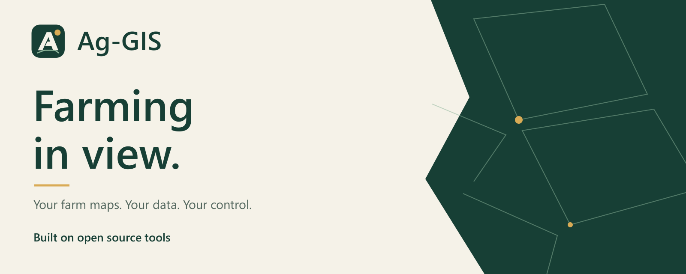
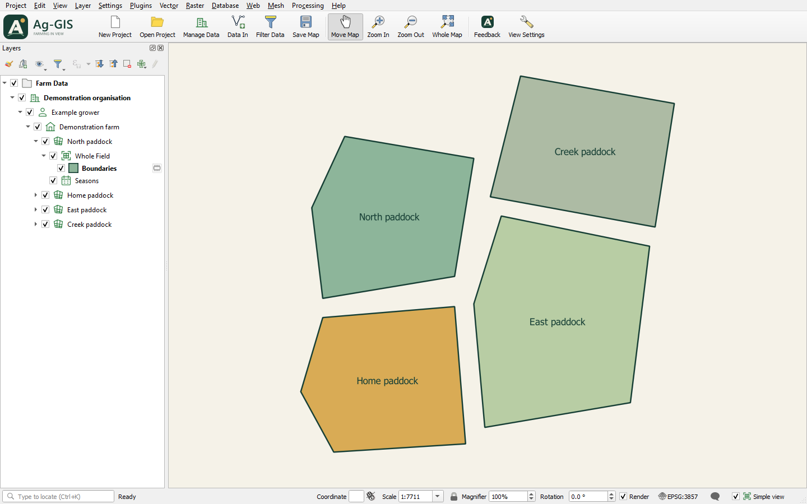

  <a href="https://github.com/Ag-Tech-and-Machine/Ag-GIS/releases"><strong>Experimental downloads</strong></a>
  &nbsp; · &nbsp;
  <a href="docs/INSTALL.md">Getting started</a>
  &nbsp; · &nbsp;
  <a href="docs/USER_GUIDE.md">User guide</a>
  &nbsp; · &nbsp;
  <a href="https://github.com/JamRov/Ag-GIS-Feedback/issues">Feedback &amp; ideas</a>

## Farm maps, without the runaround.

Ag-GIS brings farm maps and data into practical desktop workflows: organise farm information, see it on a map and spend less time on repetitive GIS work.

**Farming in view. Built on open source tools.**

> **In development — not release-ready.** Downloads are experimental snapshots. Read the release notes before installing; the current development interface may be ahead of a published installer.

*A real development desktop with generated demonstration boundaries. No customer data or online imagery. This shows local development, not a promise that an older download has the same interface.*

## A clearer place for farm information

**Keep the farm structure clear.** Organisation → Client → Farm → Field, with reusable Whole Field references separate from seasonal work. See the [farm data model](docs/FARM_DATA_MODEL.md) for what is implemented and what remains planned.

**Work from the map.** A simplified workspace brings farm tasks together while keeping the underlying mapping tools accessible. The [user guide](docs/USER_GUIDE.md) describes the workflows in each source snapshot.

**Keep control of your data.** Preserving originals, useful local operation and deliberate sharing guide the project. Optional online services are future candidates, not a requirement or a launched product.

## Try it, or help shape it

**Trying Ag-GIS?** Start with the [installation guide](docs/INSTALL.md), choose an [experimental download](https://github.com/Ag-Tech-and-Machine/Ag-GIS/releases) and use a copy of your data for evaluation. Extract the complete Windows bundle before running Setup.exe. Each release has its own source and verification limits.

**Have a farming task we should simplify?** Share the task and a safe example in [Ag-GIS Feedback](https://github.com/JamRov/Ag-GIS-Feedback/issues). Reports and attachments are public: never include private farm/customer data or credentials.

**Want to contribute?** Fork this repository and propose a focused pull request. Start with [AGENTS.md](AGENTS.md) and the [tooling notes](docs/TOOLING.md). Maintainers review changes; ideas and votes inform priorities without guaranteeing a feature or delivery date.

---

### Development, foundations and credits

The current desktop implementation uses QGIS/PyQGIS and its bundled tools. Ag-GIS is a separate project, built on open source tools, with upstream credits and licences retained and no implied endorsement. A broader toolkit is the direction, not a claim of other implemented integrations.

Read the [installation](docs/INSTALL.md), [tooling](docs/TOOLING.md) and [work log](docs/WORK_LOG.md) for prerequisites and verification. Ordinary Python can run `tools/check_plugin.py` and `tools/build_plugin.py`; real PyQGIS checks use QGIS's bundled runtime through `scripts/check.ps1`.

Cloud backup, mobile access, team synchronisation and hosted workspaces are future candidates. No paid cloud service has launched. Public source, local development and installed packages can differ.

[GPL-2.0-or-later](LICENSE) · [Repository artwork and provenance](docs/REPOSITORY_PRESENTATION.md)
